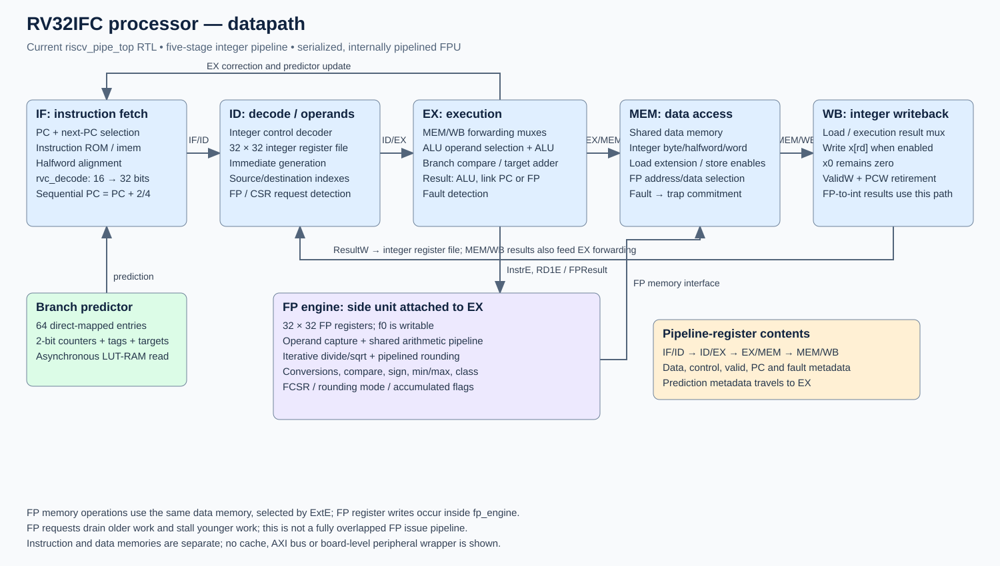

# RV32IFC processor

A Verilog RISC-V processor with a five-stage integer pipeline, compressed instruction decoding, and a serialized floating-point engine built with Berkeley HardFloat.

## Status

The included regression suite passes in the tested Windows/Icarus environment. This is an educational/research RTL project, not an ISA-certified or hardware-validated processor. The FPGA interface still exceeds the target package's I/O count; 100 MHz timing closure has not been achieved.

## Architecture

- RV32I integer execution: IF, ID, EX, MEM and WB stages, forwarding and load-use interlocks.
- RV32C decompression with mixed 16/32-bit instruction fetch.
- RV32F arithmetic, conversions, comparisons, classification, loads/stores and FCSR operations.
- 64-entry direct-mapped tagged branch predictor with two-bit counters, using distributed RAM.
- Internally pipelined shared add/multiply/FMA, iterative divide/sqrt with pipelined rounding, and pipelined integer-to-float conversion.
- FP operations drain older work and block younger work; internal pipelining does not mean one FP instruction issued per cycle.
- Separate default 1 KiB instruction and data memories; no caches or AXI interface.
- Fault recording and halt; no privileged trap-handler/interrupt implementation. No M, A or D extension.



[Control path](docs/diagrams/control.svg) · [FPU internals](docs/diagrams/fpu.svg)

## Run

Install Python 3 and Icarus Verilog (`iverilog` and `vvp` on PATH). No Python packages are required. On Windows, C:/iverilog/bin is detected automatically; IVERILOG and VVP environment variables override tool locations.

```sh
python scripts/test.py mixed
python scripts/test.py cpi
python scripts/test.py all
```

Runs use isolated `.build/` directories and do not rewrite tracked programs. The mixed test checks fixed expected values for all integer/FP registers, memory, FCSR and exact retirement order. Expected result: **240 cycles / 43 instructions = CPI 5.581395**, including pipeline fill and the terminal marker.

The full suite includes 88 architectural programs, branch/control tests, F/C integration tests, 3693 independent FP vectors, reset cancellation/restart, mixed integration and synthetic CPI workloads. Passing tests are not exhaustive ISA compliance proof. The POSIX compile path is provided but has not been executed in the Windows development environment.

## Measured results

Vivado 2019.2, xc7a35tcpg236-1, 10 ns clock constraint, **post-synthesis estimates**:

| LUTs | Registers | DSPs | Worst setup slack |
|---:|---:|---:|---:|
| 5211 | 1679 | 2 | -2.737 ns |

These reports were generated with the earlier integer demonstration ROM; the current default program is the mixed IFC ROM. Changing ROM contents can affect synthesis. Reports are retained as historical measurements, not a claim for every program/configuration. No verified 100 MHz, post-route frequency, board result or program speedup is claimed. The reported 131 external I/O signals exceed the target's 106 available pins.

Synthetic CPI: integer 1.0408, compressed 1.0408, FP-heavy 11.8317, mixed 10.2584. Suite aggregate 5.9896 applies only to that workload mix. FP wait/drain counters overlap; do not add them as independent penalties.

## Layout

- `rtl/`: processor and custom FP wrappers.
- `third_party/hardfloat/`: dependency, upstream license and provenance.
- `tests/benches/`, `tests/python/`: testbenches, generators, reference models and legacy helpers.
- `programs/`: mixed program, integer demo, listings and expected values.
- `scripts/`: portable entry point for staging and running tests.
- `fpga/`: batch synthesis script.
- `docs/diagrams/`: scalable architecture diagrams.
- `reports/`: selected historical synthesis reports.

## Synthesis

With Vivado available, from the repository root:

```sh
vivado -mode batch -source fpga/synth.tcl
```

This synthesizes the current mixed ROM. It does not perform board pin assignment, implementation or bitstream generation.

## Licensing

Berkeley HardFloat and derived files retain their upstream BSD-style notices; see `third_party/hardfloat/COPYING.txt` and `PROVENANCE.md`. No blanket license is assigned here to the project's remaining original files pending the author's choice.
